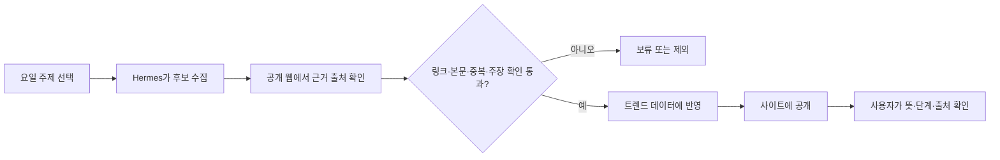

# 한끗 트렌드 이해 MVP 브리프

**문서 상태:** 발표·검증 계획 초안  
**기준일:** 2026-10-23  
**핵심 검증:** 사용자가 한끗에서 트렌드의 뜻과 현재 단계를 빠르게 이해하고, 근거 출처까지 찾을 수 있는가

## 1. 제품 한 줄 소개

한끗은 AZ 사용자가 낯선 트렌드와 표현을 짧은 설명, 현재 단계, 출처를 통해 맥락까지 이해하도록 돕는 웹 서비스다.

## 2. 해결하려는 문제와 대상

온라인에서 유행하는 말·음식·장소는 빠르게 늘지만, 사용자는 단어의 뜻만으로는 왜 주목받는지, 지금 확산 중인지 이미 지나간 유행인지 알기 어렵다. 한끗은 요약과 출처를 함께 보여 주어 사용자가 트렌드를 자기 말로 설명할 수 있도록 돕는다.

기존 PRD의 초기 대상 가설은 소셜 미디어를 깊게 따라가지 않아도 유행을 이해하고 싶은 30~50대 AZ 사용자다. 이번 MVP 발표에서는 이 가설을 검증된 사실로 취급하지 않고, 테스트 대상 선정의 출발점으로 사용한다.

## 3. MVP 가설과 범위

### 가설

트렌드 항목에 쉬운 설명, 현재 단계, 조사 시점과 근거 출처를 함께 제공하면, 처음 보는 사용자도 1분 안에 트렌드의 뜻과 현재 상태를 설명하고 그 근거를 찾을 수 있다.

### 이번 MVP에서 확인할 경험

1. 사용자가 트렌드 목록에서 관심 항목을 발견하거나 검색한다.
2. 상세 화면에서 뜻과 맥락을 읽는다.
3. 조사 시점과 현재 단계가 무엇을 뜻하는지 확인한다.
4. 출처를 열어 요약의 근거를 확인한다.
5. 항목의 뜻과 단계를 자기 말로 설명한다.

한끗의 맛집 광고·후기 신뢰 분석은 기존 제품의 보조 영역으로 남겨 두되, 이번 발표와 사용성 테스트의 중심에서는 제외한다. 이번 성공 여부는 트렌드 이해 경험으로 판단한다.

## 4. 데이터와 MVP 검증용 CSV

과제용 데이터는 새 관측값을 만들지 않고, 저장소의 기존 `backend/data/trends.json`에서 트렌드 항목만 추출해 정제했다.

| 항목 | 내용 |
|---|---|
| 파일 | `data/mvp/hangeut-trends-cleaned-2026-10-22.csv` |
| 스냅샷 기준일 | 2026-10-22 |
| 데이터 범위 | 트렌드 158건, 7개 카테고리 |
| 출처 | 총 271개 URL 참조 |
| 주요 필드 | 항목 ID·제목·카테고리·요약·단계·수집일·분석일·출처 수·출처 제목/URL·태그 |
| 제외 범위 | 신뢰분석 항목 34건은 이번 검증 주제와 달라 제외 |

요약은 기존 정의를 우선 사용하고, 정의가 비어 있는 경우 기존 발췌문을 사용했다. 목록은 발표 전 최신성을 확인해야 한다. CSV의 수집일과 분석일은 각 항목의 실제 기록값이며, 스냅샷 기준일이 모든 항목의 조사일을 의미하지 않는다.

## 5. 수집과 검증 흐름

Hermes는 요일별 주제에 맞는 후보를 모으고, 공개 웹 검색 결과와 프로젝트가 허용한 보조 지표를 이용해 근거를 확인한다. 실제 URL이 있는 출처만 기록하며, 링크와 본문이 주장에 부합하는지 확인한 뒤 통과한 항목을 데이터와 사이트에 반영한다. 소셜 플랫폼을 직접 긁어오는 방식은 사용하지 않는다.

### 요일별 수집 주제

| 요일 | 조사 주제 |
|---|---|
| 월요일 | 디저트 |
| 화요일 | 맛집·음식 |
| 수요일 | 카페·핫플 |
| 목요일 | 신조어·밈 |
| 금요일 | 노래·챌린지 |
| 토요일 | 패션 |
| 일요일 | AI 이미지 프롬프트 |

### 출처 확인 기준

- 실제로 열리는 URL이며 출처의 제목과 내용이 후보 항목에 연결되는지 본다.
- 출처 본문이 요약의 핵심 주장을 뒷받침하는지 확인한다.
- 이미 등록된 항목과 중복되는지 살핀다.
- 근거가 부족하거나 링크가 맞지 않으면 게시 후보에서 제외한다.
- 노래·챌린지 항목은 공개 검색 출처에 더해 YouTube Data API의 게시 시점·반응 지표를 보조적으로 참고할 수 있다.

요일별 자동 수집은 저장소 운영 설정에 따른다. 발표용 CSV는 기존 저장 데이터를 변환한 정적 스냅샷이므로, 실시간 조사 결과처럼 설명하지 않는다.

## 6. 동료 사용성 테스트 계획

**테스트 상태:** 참여자 섭외 전. 실제 관찰 결과는 아직 없다.

세 명을 모집해 각자 트렌드 항목 하나를 처음 보는 상황으로 테스트한다. 가능하면 기존 PRD의 대상 가설과 가까운 사용자를 포함하고, 동료만 모집할 경우 실제 핵심 사용자 검증이 아닌 초기 사용성 점검이라는 한계를 기록한다.

### 테스트 과제

> 트렌드 항목 하나를 읽고, 어떤 뜻인지와 지금 어떤 단계인지 자기 말로 설명해 주세요. 이 설명의 근거가 된 출처도 찾아 주세요.

### 성공 기준

**3명 중 2명 이상이 1분 안에 트렌드 뜻과 현재 단계를 자기 말로 설명하고, 근거 출처를 찾는다.**

### 기록할 관찰값

- 과제 완료 여부와 소요 시간
- 뜻과 현재 단계를 설명하는 데 막힌 부분
- 출처를 찾는 데 사용한 화면 요소와 혼란 지점
- 테스트 중 받은 표현·정보 구조 개선 의견

테스트 후 관찰된 문제를 우선순위에 따라 수정하고, 수정 전후를 구분해 발표한다. 미실시 상태에서 성공률이나 사용자 반응을 만들어 쓰지 않는다.

## 7. 제작·시연 일정

| 순서 | 활동 | 시간 |
|---|---|---:|
| 1 | 평가 요구사항·루브릭 확인 | 15분 |
| 2 | 실행·검증·제출 시연 | 10분 |
| 3 | 휴식 | 10분 |
| 4 | 개인 제작 스튜디오 | 120분 |
| 5 | 동료 사용성 테스트·수정 | 15분 |
| 6 | 저장소·실행 결과 제출 확인 | 10분 |

## 8. 전달물과 공개 상태

- **정제 데이터:** 저장소 내 CSV 스냅샷 158건.
- **실행 가능한 제품:** 저장소의 기존 모바일 웹 MVP.
- **저장소:** [github.com/sgustjd2/aztomz](https://github.com/sgustjd2/aztomz)
- **현재 공개 배포:** [한끗 MVP](https://aztomz-54u8pf8k2-go9mes-projects.vercel.app)
- **발표 시연:** 배포 화면에서 항목 하나를 열고 뜻·단계·출처를 확인한 뒤, 사용성 테스트 과제를 같은 흐름으로 수행한다.

## 9. 한계와 다음 행동

1. 참여자 세 명을 섭외하고 대상 특성을 간단히 기록한다.
2. 발표용 항목을 하나 고른 뒤 수집일·분석일·출처 링크의 현재성을 다시 확인한다.
3. 성공 기준에 맞춰 시간과 완료 여부를 기록한다.
4. 실제 테스트에서 드러난 혼란 지점을 수정하고, 변경 내용을 시연 자료에 반영한다.

이 MVP는 트렌드 이해를 돕는 정보 구조의 초기 검증이다. 트렌드 단계 표시는 수집 데이터에 기반한 분류이며, 모든 사용자의 관심이나 유행의 미래를 보장하는 예측으로 설명하지 않는다. 테스트 전에는 사용성 개선 효과를 주장하지 않는다.
